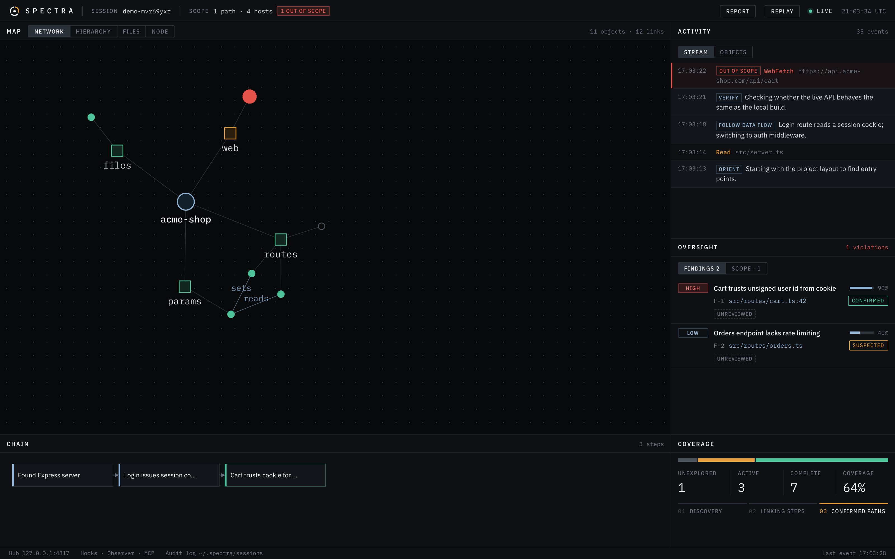

# Spectra

**A live, read-only dashboard for watching a Claude Code agent work.** Spectra turns the agent's terminal stream into a local dashboard showing:
- what it explored, as a map,
- the hosts, subdomains and API routes it contacted,
- the chain of steps behind each finding,
- anything it touched outside the scope you set.

Every session is recorded so you can replay it afterwards.



Spectra **observes; it never drives**. It doesn't send prompts, approve tools or run commands. The hook it installs prints nothing and always exits 0, so it can't block, change or noticeably slow a tool call.

It's built for oversight of agent-assisted security work on targets you're authorized to test: your own code, a pentest engagement, or a bug bounty program within its published scope.

---

## What you see

| Panel | Shows |
|---|---|
| **Map → Network** | Force-directed graph of everything the agent touched: files, searches, commands, MCP tools, and the hosts it contacted |
| **Map → Hierarchy** | Collapsible tree: session → category → item, including **domain → subdomain → API route** |
| **Map → Files** | Review coverage: every file in scope marked read, edited or never opened, with per-folder coverage and an "unopened only" filter |
| **Map → Node** | One object in detail: properties, neighbours, every tool call that touched it, and any scope violations |
| **Activity** | Live stream of tool calls, the agent's reasoning, and your prompts; out-of-scope calls are marked in red |
| **Oversight → Findings** | Bugs the agent reported, ranked by status, severity and confidence. Each shows its evidence trail, the edits made to the affected file, and your review |
| **Oversight → Scope** | The current scope and every out-of-scope access (path or host, read / write / exec / network) |
| **Chain** | How the agent linked smaller observations into a larger finding |
| **Coverage** | Unexplored / active / complete counts and the discovery → linking → confirmed progression |
| **Replay** | Scrub, step or play back any recorded session, with violations and findings marked on the timeline |
| **Report** | Download a Markdown summary of the session: scope, findings with review verdicts and remediation, violations, files edited |

### Reviewing the agent's work

- **Your verdict, kept separate.** Expand a finding to mark it *Verified*, *Rejected* or *Needs info* and add a note. The agent's own status ("confirmed", "fixed") stays visible next to your verdict, and the agent can't set verdicts.
- **Remediation.** When the agent edits the file named in a finding's location, the edit is linked to that finding automatically.
- **What wasn't checked.** The Files view lists every file in scope, including the ones the agent never opened, so gaps in the review are visible.
- **Alerts.** Each out-of-scope access sends a desktop notification (macOS and Linux; bursts are grouped, at most one every 5 seconds), and the browser tab title shows the violation count.

### How recon shows up

Every URL the agent requests is added to the **hosts** tree. That covers WebFetch, browser MCP tools, and `curl`/`wget` URLs inside shell commands.

```
hosts
└─ example-shop.test
   ├─ api.example-shop.test
   │  ├─ /v1/users/:id
   │  ├─ /v1/users/:id/orders
   │  └─ /v1/orders/:id
   └─ admin.example-shop.test
      └─ /login
```

Numeric IDs, UUIDs and long hex strings are collapsed to `:id`, so the API's shape shows up instead of thousands of one-off URLs.

Spectra maps what the agent *touched*; it doesn't read tool output. Subdomains or routes the agent *discovers* (for example in a scanner's output) appear when the agent records them with the MCP tools below.

---

## Install

**Requirements:** Node.js 20+, Claude Code, macOS or Linux (Windows works through WSL).

### 1. Clone and start the dashboard

```bash
git clone https://github.com/joshmaster2165/spectra.git
cd spectra
npm install
npm start
```

Open **http://127.0.0.1:4317**. Leave this terminal running; the dashboard updates live.

### 2. Set your scope

Copy the example config and list the folders and hosts the agent is allowed to touch:

```bash
cp spectra.config.example.json spectra.config.json
```

```json
{
  "scope": {
    "paths": ["/Users/you/code/target-repo"],
    "hosts": ["example-shop.test"]
  }
}
```

- Hosts include their subdomains (`example-shop.test` covers `api.example-shop.test`).
- `localhost`, `127.0.0.1` and `::1` are always in scope.
- With no config, each session's working directory is its scope and every non-local host is flagged.
- Restart `npm start` after editing.

You can also change scope while it's running:

```bash
curl -X POST http://127.0.0.1:4317/scope -H 'content-type: application/json' -d '{"paths":["/Users/you/code/target-repo"],"hosts":["example-shop.test"]}'
```

The agent has no tool to change the scope or review verdicts, and Spectra rejects those events when they're sent the way the agent sends annotations.

### 3. Connect Claude Code

**Hooks (recommended)** report every tool call the moment it happens. Install them for one project:

```bash
npm run hooks:install -- /path/to/target-repo
```

This adds Spectra's hooks to `/path/to/target-repo/.claude/settings.local.json` and keeps your existing settings. To watch every project instead:

```bash
npm run hooks:install -- --user
```

To remove them, add `--remove` to either command. Restart any running Claude Code sessions after installing.

**No hooks?** Spectra also tails Claude Code's session logs in `~/.claude/projects/`, so you'll see activity without them. Hooks are more reliable because the log format isn't a public API.

### 4. (Optional) Let the agent annotate the map

Register the MCP server so the agent can record what it discovers and report findings:

```bash
claude mcp add spectra -- npx tsx "$(pwd)/packages/server/src/mcp.ts"
```

| Tool | Use |
|---|---|
| `map_topology_node` | Add something discovered (a subdomain, route, parameter, module) to the map |
| `link_nodes` | Connect two map objects with a labelled edge |
| `update_chain` | Add a step to the reasoning chain behind a finding |
| `report_finding` | Report a bug: severity, confidence, status, file/line, supporting steps |
| `log_thought` | Explain a change of direction |

Anything reported this way is labelled **agent-reported** in the dashboard. Treat it as the agent's claim and check it against the evidence; the hooks and logs record what actually ran.

A line like this in the project's `CLAUDE.md` helps the agent use them:

> Record discovered hosts, routes and parameters with `map_topology_node`, and report suspected bugs with `report_finding`, linking the chain steps that support them.

### 5. Try it without an agent

```bash
npm run demo
```

This plays a scripted audit session with a confirmed finding and a scope violation.

---

## How it works

```
                 hooks  ── bin/spectra-hook.mjs ──POST /hooks──┐
 Claude Code ──┤  logs  ── ~/.claude/projects (observer) ──────┤
                 MCP    ── src/mcp.ts ──────────POST /events──┤
                                                               ▼
                         Hub (packages/server): scope checks, dedupe, audit log
                                                               │ WebSocket
                                                               ▼
                                         Dashboard (packages/web, React)
```

| Source | Provides | Trust |
|---|---|---|
| Hooks | Every tool call and result, in real time | What actually ran |
| Log observer | The agent's reasoning text; tool calls when hooks aren't installed | What actually ran |
| MCP server | Discoveries, chain steps, findings | The agent's claims |

When a session reports through hooks, the log observer's copies of its tool calls are dropped so nothing is counted twice.

**Scope checks:**
- **Read** outside scope is *medium*.
- **Write**, **shell (exec)** and **network** access outside scope are *high*.
- Paths and URLs inside shell commands are found by pattern-matching and marked "parsed from shell". A command that builds a path dynamically can slip past it, so treat a clean scope tab as a strong signal, not a guarantee.

**Audit log:** every event is appended to `~/.spectra/sessions/<session-id>.jsonl` with owner-only permissions. **Replay** in the top bar reads from it, so sessions survive restarts.

### Repository layout

```
packages/schema   Event types and the shared reducer (hub, dashboard and replay use the same one)
packages/server   Hub, log observer, scope checks, MCP server, hook script and installer
packages/web      Dashboard (React + Vite, d3-force)
```

---

## Security and privacy

- **Everything stays on your machine.** The hub listens on 127.0.0.1 only and makes no outbound connections.
- **Other websites can't read it.** The hub refuses requests and WebSocket connections from non-local browser origins, so a page you have open can't read the agent's activity.
- **The audit log is sensitive.** It contains what the agent saw: file paths, command lines, URLs, your prompts and the agent's reasoning. The hook strips file contents and patches before sending, but treat the log like your shell history. Delete `~/.spectra/sessions` to clear it.
- **Any local process can send events to the hub.** Agent annotations are labelled, but if you need tamper-evidence, rely on the hook and log records.

## Configuration

| Variable | Default | |
|---|---|---|
| `SPECTRA_PORT` | `4317` | Hub and dashboard port |
| `SPECTRA_CONFIG` | `./spectra.config.json` | Scope config file |
| `SPECTRA_SCOPE_PATHS` / `SPECTRA_SCOPE_HOSTS` | | Comma-separated; override the config file |
| `SPECTRA_DATA_DIR` | `~/.spectra/sessions` | Audit log location |
| `SPECTRA_PERSIST=0` | | Don't write the audit log |
| `SPECTRA_OBSERVER=0` | | Don't read Claude Code's session logs |
| `SPECTRA_NOTIFY=0` | | Turn off desktop notifications for scope violations |
| `SPECTRA_REPLAY=1` | | Load existing session logs on start, not just new activity |
| `SPECTRA_HUB` | `http://127.0.0.1:4317` | Where the hook, MCP server and demo send events |

## Development

```bash
npm run dev         # hub with reload + Vite dashboard on http://localhost:5173
npm run typecheck
```

## License

MIT
