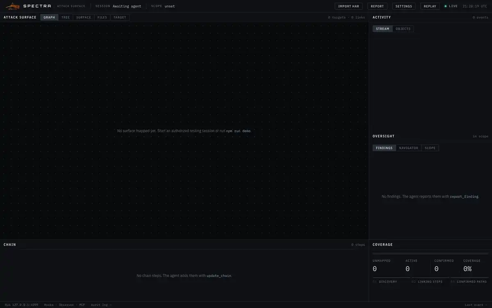
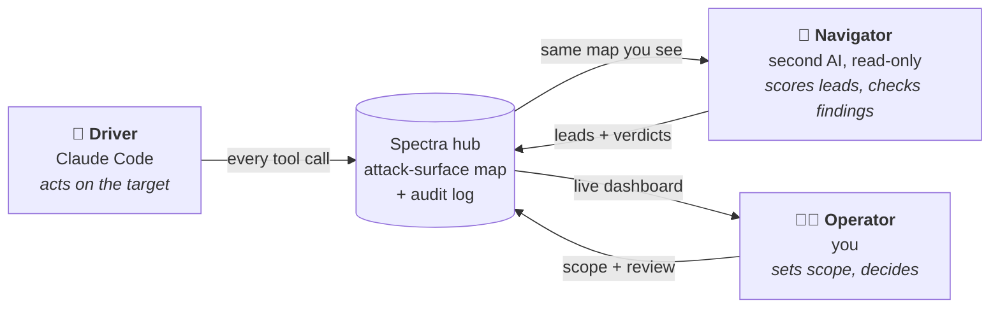
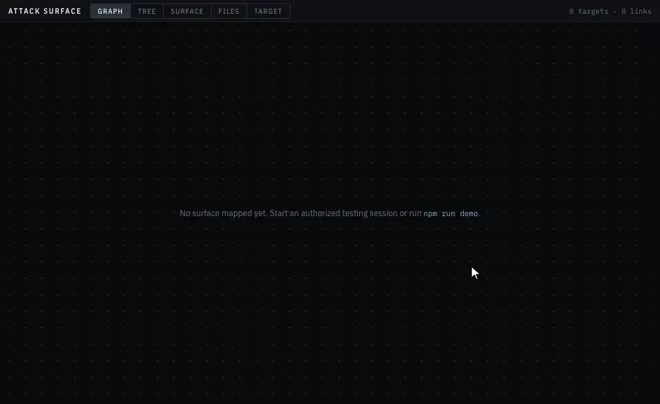
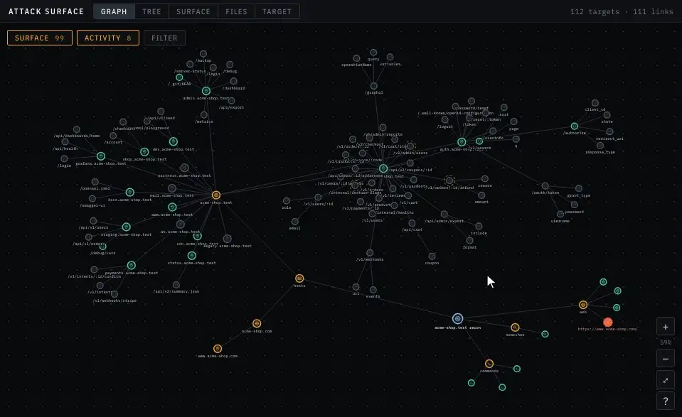
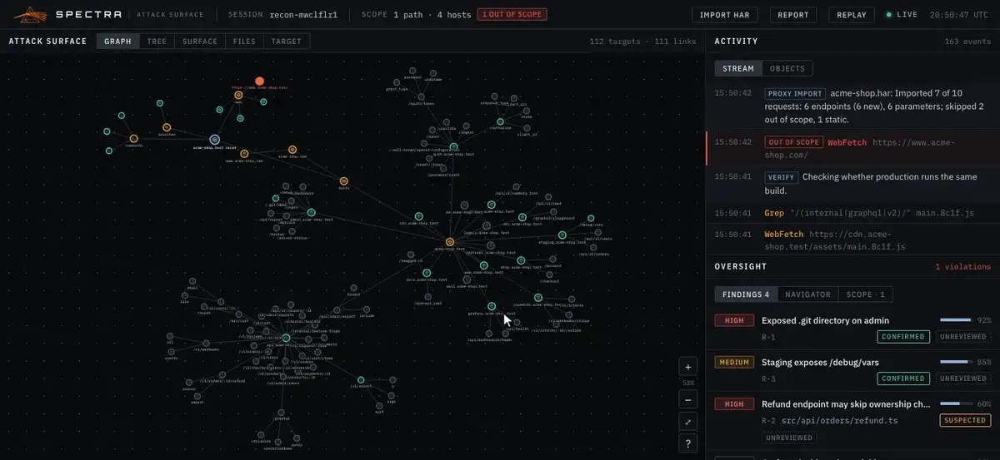
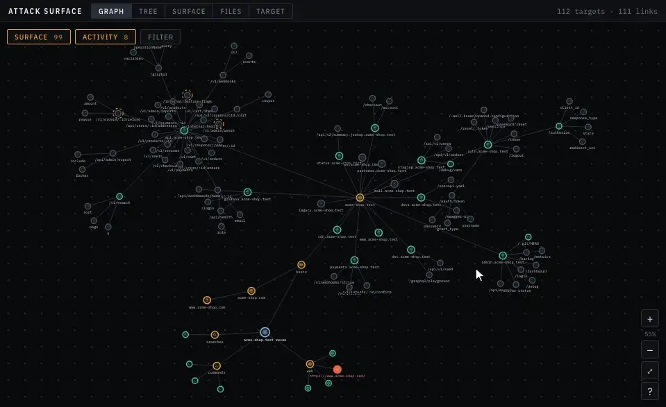
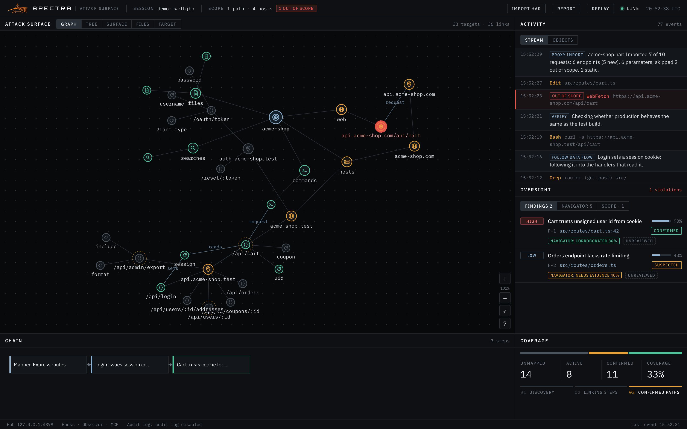
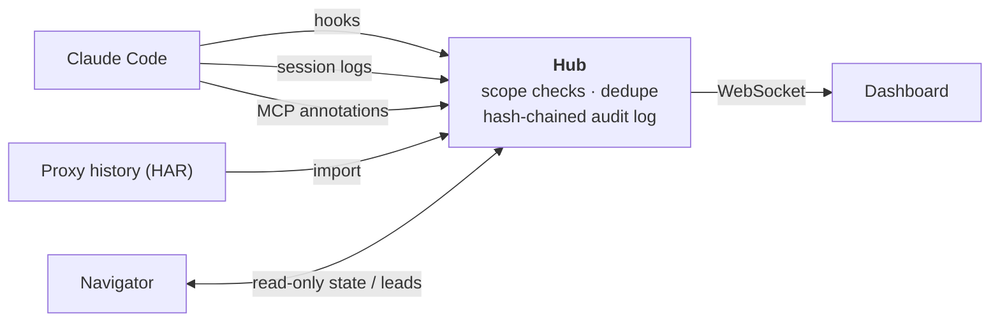

<p align="center"></p>

<p align="center">
  <b>A live attack-surface map for authorized, AI-assisted bug hunting.</b><br>
  Watch a Claude Code agent map hosts, subdomains, endpoints and parameters in real time —<br>
  with a second AI scoring where to dig, and a hard line around what you authorized.
</p>

<p align="center">
  <a href="LICENSE"></a>
  
  
  
</p>

<p align="center"></p>
<p align="center"><sub>A recon engagement against a fictional, authorized target — <code>npm run demo:recon</code> · <a href="docs/media/demo.mp4">full-quality MP4</a></sub></p>

---

## Three seats, one target

AI agents are good at recon and bad at telling you what they did. Spectra puts the work on a map and gives every role its own seat:



- **The driver acts.** Claude Code does the testing. Spectra records every file it reads, command it runs and URL it requests — but **never drives**: it sends no prompts, approves no tools, and its hook can't block or slow a call.
- **The Navigator advises.** An optional second model reads the same map and points at the promise — *pursue / watch / skip*, a suspected bug class, a confidence score — and gives an independent verdict on each finding. It never touches the target.
- **You decide.** You set the scope, review findings, and see instantly when anything crosses the line.

## Quick start

```bash
git clone https://github.com/joshmaster2165/spectra.git
cd spectra && npm install
npm start          # dashboard on http://127.0.0.1:4317
npm run demo       # in a second terminal: a scripted engagement against acme-shop.test
npm run demo:recon # or the bigger one from the video: ~110 targets of recon
```

The demo authorizes `acme-shop.test`, maps its API, confirms an IDOR in the cart, links the fix, and strays once to production — which lights up red. Then it imports a proxy history that reveals endpoints the agent never touched. When you're ready for a real engagement, follow the [setup guide](docs/setup.md).

**Documentation:** [Getting started](docs/getting-started.md) · [Setup guide](docs/setup.md) · [Dashboard tour](docs/dashboard.md) · [The Navigator](docs/navigator.md) · [Proxy import](docs/proxy-import.md) · [Reference](docs/reference.md) · [Configuration](docs/configuration.md) · [Security model](docs/security.md) · [Troubleshooting](docs/troubleshooting.md)

## See it in action

### Sort the attack surface as it comes in

<p align="center"></p>

The **Surface** view is every endpoint, host or parameter as a live table, newest first so discoveries land on top. Each target is tagged automatically (`api`, `auth`, `admin`, `internal`, `payments`, `object-id`…), and you can sort by any column — the Navigator's score, your triage mark, status, source, request count. Mark targets **To test / Testing / Tested / Skip** as you go, then export the rows as CSV. [More →](docs/dashboard.md)

### Filter the map down to what matters

<p align="center"></p>

One filter bar drives both the graph and the table: search, tags, status, scored leads, and your triage marks. Everything that doesn't match dims, matches stay connected to their hosts, and layers hide the agent's activity so only the attack surface is left. [More →](docs/dashboard.md)

### Let the Navigator point the way

<p align="center"></p>

The **Navigator** is a second model in the second seat. It reads the map you see, scores where the bugs are likely to be — *pursue*, *watch* or *skip*, with a bug class, a 0–100% confidence and a one-line reason — and independently corroborates or challenges each finding. Advice only: it never touches the target or promotes anything out of scope. Turn it on from **Settings** with its own API key. [How it works →](docs/navigator.md)

### Walk the hierarchy

<p align="center"></p>

The **Tree** view lays the same surface out as **domain → subdomain → endpoint → parameter**, with counts and status at every level. Collapse what you've covered, drill into what you haven't, and double-click anything to open it in **Target**. [More →](docs/dashboard.md)

## What you get



**Map the attack surface**
- A zoomable, pannable graph of everything the agent touched, with an icon per target type — domains, subdomains, endpoints, parameters, files, searches, shell commands, MCP tools — that keeps new discoveries in frame as it grows.
- Every URL becomes a **domain → subdomain → endpoint** tree; numeric IDs, UUIDs, hashes and tokens collapse to `:id` / `:token`, so you see the API's shape, not ten thousand one-off URLs.
- A sortable **Surface** table and a collapsible **Tree** of the same map, with automatic tags and one filter bar shared with the graph.
- **Import proxy history** (HAR from browser DevTools or any proxy that exports it). Traffic merges onto the same map, and surface the agent never touched shows up as *unmapped* — a ready-made to-do list.
- Code-review coverage: every in-scope file marked read, edited or **never opened**.

**Stay inside the lines**
- You define the scope (paths and hosts). Every out-of-scope read, write, exec or network call is flagged in red, with a desktop alert.
- The agent has no tool to change scope or verdicts, and the hub rejects them on its annotation channel.

**Organize the hunt**
- **Triage marks** on any target — To test, Testing, Tested, Skip — with notes, so recon turns into a worklist before you move to the next phase.
- **Pick up where you left off.** The map, your marks, findings and leads come back when the hub restarts; **New engagement** in Settings clears it for the next target.
- Export the surface as **CSV**, or a **Markdown report** with the surface, tags, leads, your triage and the findings.

**Get a second opinion**
- The **Navigator** ranks leads by promise and corroborates or challenges each finding — shown beside the agent's own claim and your review, never mixed with them. It sees your triage marks, and you set it up from **Settings**.

**Prove what happened**
- Findings carry their attack chain, the edits that fixed them, and your verdict.
- Replay any session; export a Markdown report.
- A **hash-chained audit log** makes after-the-fact edits detectable.

## Spectra vs. an intercepting proxy

Spectra is not Burp, Caido or ZAP, and doesn't try to be. They show you **traffic**; Spectra shows you **the agent**.

| | Intercepting proxy | Spectra |
|---|---|---|
| Sees | Every request and response on the wire | Every action the agent takes: files, commands, searches, requests, its reasoning |
| Answers | *What did the server say?* | *What did the agent do, why, and did it stay in scope?* |
| Modifies traffic | Yes — intercept, replay, fuzz | Never — observe only |
| Second opinion | — | The Navigator scores leads and findings |
| Evidence | Request history | Hash-chained audit log of the whole engagement |

They're complementary: run the agent through your proxy, watch it in Spectra, then [import the proxy's history](docs/proxy-import.md). Every endpoint the proxy saw lands on the same map, and anything the agent hasn't tested shows up as unmapped.

---

## Setup in brief

**Requirements:** Node.js 20+, Claude Code, macOS or Linux (Windows through WSL). The [setup guide](docs/setup.md) covers every step in full, and **Settings → Setup** in the dashboard shows what's connected.

1. **Set your scope** — the folders and hosts you're authorized to test. Hosts include their subdomains; loopback is always in scope.
   ```bash
   cp spectra.config.example.json spectra.config.json   # then list your paths and hosts
   ```
2. **Connect Claude Code** with hooks, so every tool call reaches Spectra as it happens:
   ```bash
   npm run hooks:install -- /path/to/target-repo   # or --user for every project
   ```
3. **Let the agent annotate the map** (optional) — register the MCP server so it can record what it *discovers* and report findings. From the Spectra folder:
   ```bash
   claude mcp add spectra -- "$(pwd)/node_modules/.bin/tsx" "$(pwd)/packages/server/src/mcp.ts"
   ```
4. **Turn on the Navigator** (optional) — the second model that scores leads and checks findings. Open **Settings** in the dashboard, add its API key, press **Test connection**, and switch it on. (Or run it as its own process: `ANTHROPIC_API_KEY=… npm run validator`.)
5. **Import proxy history** (optional) — click **Import HAR** in the dashboard, or:
   ```bash
   npm run import -- burp-history.har
   ```

## How it works



Every event carries its source, and sources are trusted differently:

| Source | Provides | Trust |
|---|---|---|
| Hooks · log observer | Every tool call and result, the agent's reasoning | **Ground truth** — what actually ran |
| MCP server | Discoveries, chain steps, findings | **Claims** — the agent's word |
| Proxy import | Hosts, endpoints and parameter names from proxy history | **Observed traffic** — what crossed the wire |
| Navigator | Leads and finding verdicts | **Advice** — a second model's read |
| Operator | Scope, review verdicts and triage marks | **Authority** — yours alone |

```
packages/schema   Event types, the shared reducer and the HAR parser (hub, dashboard and replay share them)
packages/server   Hub, log observer, scope checks, MCP server, Navigator, proxy import, hook script and installer
packages/web      Dashboard (React, Vite, d3-force)
```

The [reference](docs/reference.md) documents every MCP tool and hub route; [configuration](docs/configuration.md) lists every environment variable.

## Security and privacy

- **Local hub.** The hub listens on `127.0.0.1` and refuses requests and WebSockets from non-local browser origins. It makes no outbound connections unless you turn on the Navigator, which calls the Anthropic API. The dashboard also loads its fonts from Google Fonts.
- **The Navigator's key stays put.** A key entered in Settings is stored in `~/.spectra/settings.json`, readable only by you, and is never sent back to the browser.
- **Tamper-evident.** Every event is appended to a hash-chained audit log; `npm run verify` checks it, and exported reports carry the head hash.
- **Names, not values.** Proxy imports keep parameter names and drop query strings, bodies and credentials before anything reaches the hub.
- **The audit log is sensitive.** It holds paths, commands, URLs, your prompts and the agent's reasoning. Treat it like shell history.

Spectra is for testing you're **authorized** to do — your own code, a contracted engagement, or a bug bounty program within its published scope. The [security model](docs/security.md) covers the details and limits; [SECURITY.md](SECURITY.md) covers responsible use and how to report a vulnerability in Spectra itself.

## Roadmap

- **Live proxy feed** — a passive mitmproxy add-on that streams traffic onto the map as it happens (today: HAR import). Ingest only: Spectra stays read-only.
- **Response-aware recon** — opt-in extraction of links, routes and parameters from tool output.
- **Report export** — findings with their attack chain and audit head hash, in bug-bounty report format.

## Development

```bash
npm run dev         # hub with reload + Vite dashboard on http://localhost:5173
npm run typecheck
```

## License

[MIT](LICENSE)
