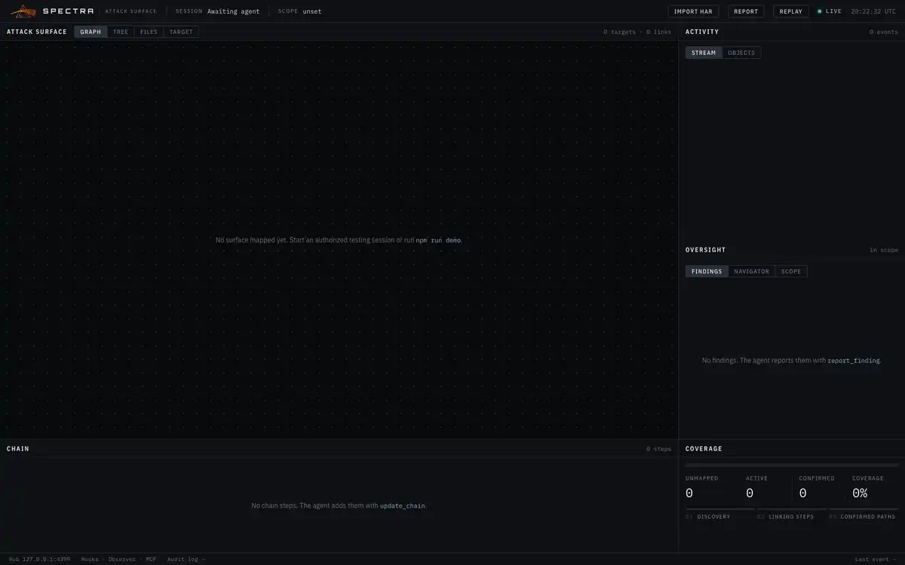
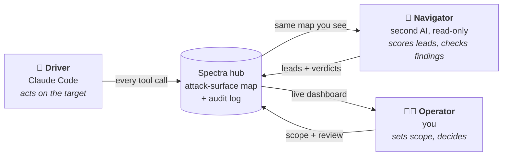
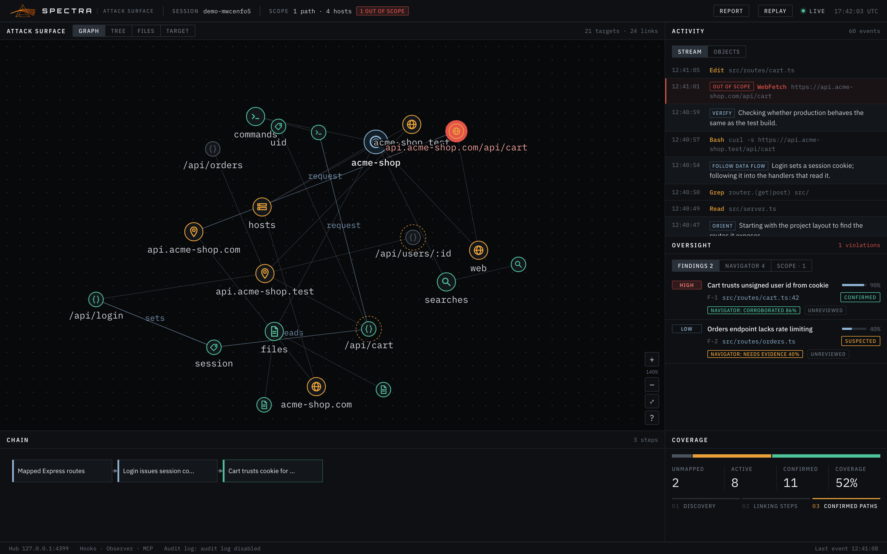
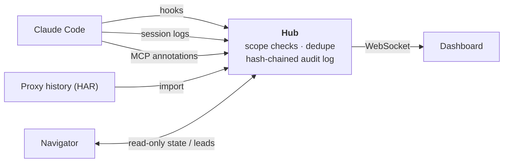

<p align="center"></p>

<p align="center">
  <b>A live attack-surface map for authorized, AI-assisted bug hunting.</b><br>
  Watch a Claude Code agent map hosts, subdomains, endpoints and parameters in real time —<br>
  with a second AI scoring where to dig, and a hard line around what you authorized.
</p>

<p align="center">
  <a href="LICENSE"></a>
  
  
  
</p>

<p align="center"></p>
<p align="center"><sub>A recon engagement against a fictional, authorized target — <code>npm run demo:recon</code> · <a href="docs/demo.mp4">full-quality MP4</a></sub></p>

---

## Three seats, one target

AI agents are good at recon and bad at telling you what they did. Spectra puts the work on a map and gives every role its own seat:



- **The driver acts.** Claude Code does the testing. Spectra records every file it reads, command it runs and URL it requests — but **never drives**: it sends no prompts, approves no tools, and its hook can't block or slow a call.
- **The Navigator advises.** An optional second model reads the same map and points at the promise — *pursue / watch / skip*, a suspected bug class, a confidence score — and gives an independent verdict on each finding. It never touches the target.
- **You decide.** You set the scope, review findings, and see instantly when anything crosses the line.

## Quick start

```bash
git clone https://github.com/joshmaster2165/spectra.git
cd spectra && npm install
npm start          # dashboard on http://127.0.0.1:4317
npm run demo       # in a second terminal: a scripted engagement against acme-shop.test
npm run demo:recon # or the bigger one from the video: ~110 targets of recon
```

The demo authorizes `acme-shop.test`, maps its API, confirms an IDOR in the cart, links the fix, and strays once to production — which lights up red. Then it imports a proxy history that reveals endpoints the agent never touched. Next, [connect a real session](#connect-claude-code) or [import your own proxy history](#import-proxy-history).

## What you get



**Map the attack surface**
- A zoomable, pannable graph of everything the agent touched, with an icon per target type — domains, subdomains, endpoints, parameters, files, searches, shell commands, MCP tools.
- Every URL becomes a **domain → subdomain → endpoint** tree; numeric IDs, UUIDs and hashes collapse to `:id`, so you see the API's shape, not ten thousand one-off URLs.
- **Import proxy history** (HAR from Burp, Caido, ZAP or browser devtools). Traffic merges onto the same map, and surface the agent never touched shows up as *unmapped* — a ready-made to-do list.
- Code-review coverage: every in-scope file marked read, edited or **never opened**.

**Stay inside the lines**
- You define the scope (paths and hosts). Every out-of-scope read, write, exec or network call is flagged in red, with a desktop alert.
- The agent has no tool to change scope or verdicts, and the hub rejects them on its annotation channel.

**Get a second opinion**
- The **Navigator** ranks leads by promise and corroborates or challenges each finding — shown beside the agent's own claim and your review, never mixed with them.

**Prove what happened**
- Findings carry their attack chain, the edits that fixed them, and your verdict.
- Replay any session; export a Markdown report.
- A **hash-chained audit log** makes after-the-fact edits detectable.

## Spectra vs. an intercepting proxy

Spectra is not Burp, Caido or ZAP, and doesn't try to be. They show you **traffic**; Spectra shows you **the agent**.

| | Intercepting proxy | Spectra |
|---|---|---|
| Sees | Every request and response on the wire | Every action the agent takes: files, commands, searches, requests, its reasoning |
| Answers | *What did the server say?* | *What did the agent do, why, and did it stay in scope?* |
| Modifies traffic | Yes — intercept, replay, fuzz | Never — observe only |
| Second opinion | — | The Navigator scores leads and findings |
| Evidence | Request history | Hash-chained audit log of the whole engagement |

They're complementary: run the agent through your proxy, watch it in Spectra, then [import the proxy's history](#import-proxy-history). Every endpoint the proxy saw lands on the same map, and anything the agent hasn't tested shows up as unmapped.

---

## Setup

**Requirements:** Node.js 20+, Claude Code, macOS or Linux (Windows through WSL).

### Set your scope

```bash
cp spectra.config.example.json spectra.config.json
```

```json
{
  "scope": {
    "paths": ["/Users/you/code/target-repo"],
    "hosts": ["example-shop.test"]
  }
}
```

- Hosts include their subdomains (`example-shop.test` covers `api.example-shop.test`).
- `localhost`, `127.0.0.1` and `::1` are always in scope.
- With no config, each session's working directory is its scope and every non-local host is flagged.
- Restart `npm start` after editing, or change it live:

```bash
curl -X POST http://127.0.0.1:4317/scope -H 'content-type: application/json' \
  -d '{"paths":["/Users/you/code/target-repo"],"hosts":["example-shop.test"]}'
```

### Connect Claude Code

**Hooks (recommended)** report every tool call the moment it happens:

```bash
npm run hooks:install -- /path/to/target-repo   # one project
npm run hooks:install -- --user                 # every project
```

This merges Spectra's hooks into `.claude/settings.local.json` (or your user settings) and keeps what's there. Add `--remove` to undo. Restart running Claude Code sessions afterwards.

**No hooks?** Spectra also tails Claude Code's session logs in `~/.claude/projects/`. Hooks are more reliable — the log format isn't a public API.

### Let the agent annotate the map (optional)

Spectra maps what the agent *touched*. To also map what it *discovers* — a subdomain in scanner output, a parameter in a JS bundle — register the MCP server:

```bash
claude mcp add spectra -- npx tsx "$(pwd)/packages/server/src/mcp.ts"
```

| Tool | Use |
|---|---|
| `map_target` | Add a discovered target (host, subdomain, endpoint, parameter, module) to the map |
| `link_nodes` | Connect two targets with a labelled edge |
| `update_chain` | Add a step to the attack chain behind a finding |
| `report_finding` | Report a vulnerability: severity, confidence, status, file/line, supporting steps |
| `log_thought` | Explain a change of direction |

Anything reported this way is labelled **agent-reported** — a claim to check, not ground truth. This line in the project's `CLAUDE.md` helps:

> Record discovered hosts, subdomains, endpoints and parameters with `map_target`, and report suspected vulnerabilities with `report_finding`, linking the attack-chain steps that support them.

### Import proxy history

Export your proxy's history as a HAR file — most proxies can, directly or through an extension, and any browser's DevTools can (*Network → Save all as HAR*). Then click **Import HAR** in the dashboard, or run:

```bash
npm run import -- burp-history.har          # several files at once is fine
npm run import -- examples/acme-shop.har    # a sample to try
```

- **Same map, merged.** Endpoints use the same ids as the agent's traffic, so an endpoint the proxy saw and the agent touched is one node, marked *seen in agent and proxy traffic* with its request count, methods and status codes. Endpoints only the proxy saw arrive as **unmapped**, and the Navigator weighs them as untested leads.
- **Scope-filtered.** Only hosts in your scope are imported; third-party hosts (CDNs, analytics) and static assets are skipped and listed, the way a proxy's "in-scope only" view works. Add `--include-static` to keep scripts, styles and images.
- **Names, never values.** Parsing happens on your side (in the browser, or the CLI): only methods, URLs without their query strings, status codes, content types and parameter **names** are sent. Passwords, tokens and cookies never reach the hub, and token-like path segments collapse to `:token`.

### Start the Navigator (optional)

```bash
export ANTHROPIC_API_KEY=sk-ant-...
npm run validator
```

The Navigator connects to the hub as a read-only client, rebuilds the same state you see, and posts leads and verdicts back on its own endpoint — the agent's annotation tools can't produce them. It gives **direction and prioritization only** — triage, not exploit payloads — and never promotes an out-of-scope target. `SPECTRA_VALIDATOR_MODEL` picks the model (default `claude-opus-5-5`).

> The Navigator is the only part of Spectra that makes an outbound connection (to the Anthropic API). Leave it off for zero egress.

---

## How it works



Every event carries its source, and sources are trusted differently:

| Source | Provides | Trust |
|---|---|---|
| Hooks · log observer | Every tool call and result, the agent's reasoning | **Ground truth** — what actually ran |
| MCP server | Discoveries, chain steps, findings | **Claims** — the agent's word |
| Proxy import | Hosts, endpoints and parameter names from proxy history | **Observed traffic** — what crossed the wire |
| Navigator | Leads and finding verdicts | **Advice** — a second model's read |
| Operator | Scope and review verdicts | **Authority** — yours alone |

**Scope checks.** Reads outside scope are *medium*; writes, shell execution and network access are *high*. Paths and URLs inside shell commands are found by pattern-matching and marked "parsed from shell" — a command that builds a path dynamically can slip past, so treat a clean scope tab as a strong signal, not a guarantee.

**Tamper-evident log.** Every event is appended to `~/.spectra/sessions/<session-id>.jsonl` (owner-only), each line chained to the previous line's SHA-256. Editing, deleting or reordering a line breaks the chain. The footer re-verifies every 30 seconds and shows the **head hash**; exported reports include it, so a log rewritten later fails verification against the head you kept.

```bash
npm run verify                         # check every recorded session
npm run verify -- <session-id> <head>  # also confirm a head hash you recorded
```

```
packages/schema   Event types and the shared reducer (hub, dashboard and replay use the same one)
packages/server   Hub, log observer, scope checks, MCP server, Navigator, hook script and installer
packages/web      Dashboard (React, Vite, d3-force)
```

## Security and privacy

- **Local only.** The hub listens on `127.0.0.1` and refuses requests and WebSockets from non-local browser origins.
- **The audit log is sensitive.** It holds file paths, commands, URLs, your prompts and the agent's reasoning (file contents and patches are stripped). Treat it like shell history; delete `~/.spectra/sessions` to clear it.
- **Imports keep names, not values.** Proxy history is reduced on your side before it reaches the hub — see [Import proxy history](#import-proxy-history).
- **Any local process can post events.** Labels and the hash chain make claims and after-the-fact edits visible, but events injected live are chained like any other.

Spectra is for testing you're **authorized** to do — your own code, a contracted engagement, or a bug bounty program within its published scope. See [SECURITY.md](SECURITY.md) for responsible use and how to report a vulnerability in Spectra itself.

## Configuration

| Variable | Default | |
|---|---|---|
| `SPECTRA_PORT` | `4317` | Hub and dashboard port |
| `SPECTRA_CONFIG` | `./spectra.config.json` | Scope config file |
| `SPECTRA_SCOPE_PATHS` / `SPECTRA_SCOPE_HOSTS` | | Comma-separated; override the config file |
| `SPECTRA_DATA_DIR` | `~/.spectra/sessions` | Audit log location |
| `SPECTRA_PERSIST=0` | | Don't write the audit log |
| `SPECTRA_OBSERVER=0` | | Don't read Claude Code's session logs |
| `SPECTRA_NOTIFY=0` | | No desktop alerts for scope violations |
| `SPECTRA_REPLAY=1` | | Load existing session logs on start |
| `SPECTRA_HUB` | `http://127.0.0.1:4317` | Where the hook, MCP server, Navigator and demo connect |
| `SPECTRA_VALIDATOR_MODEL` | `claude-opus-5-5` | Model the Navigator uses |

## Roadmap

- **Live proxy feed** — a passive mitmproxy add-on that streams traffic onto the map as it happens (today: HAR import). Ingest only: Spectra stays read-only.
- **Response-aware recon** — opt-in extraction of links, routes and parameters from tool output.
- **Report export** — findings with their attack chain and audit head hash, in bug-bounty report format.

## Development

```bash
npm run dev         # hub with reload + Vite dashboard on http://localhost:5173
npm run typecheck
```

## License

[MIT](LICENSE)
