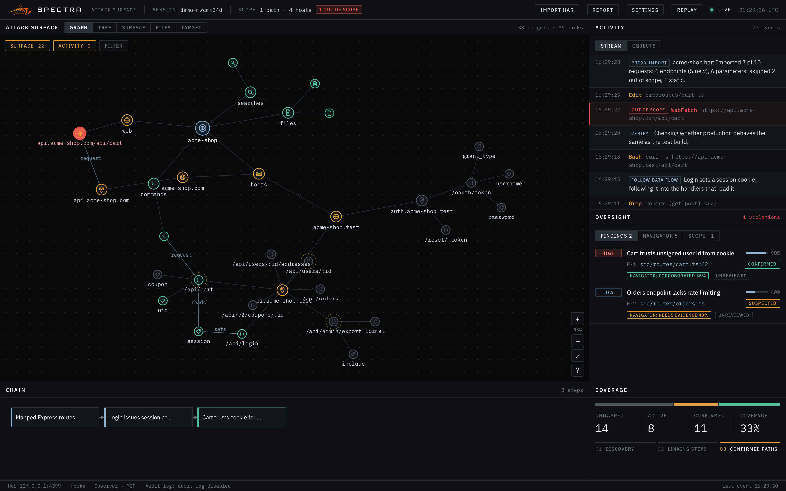
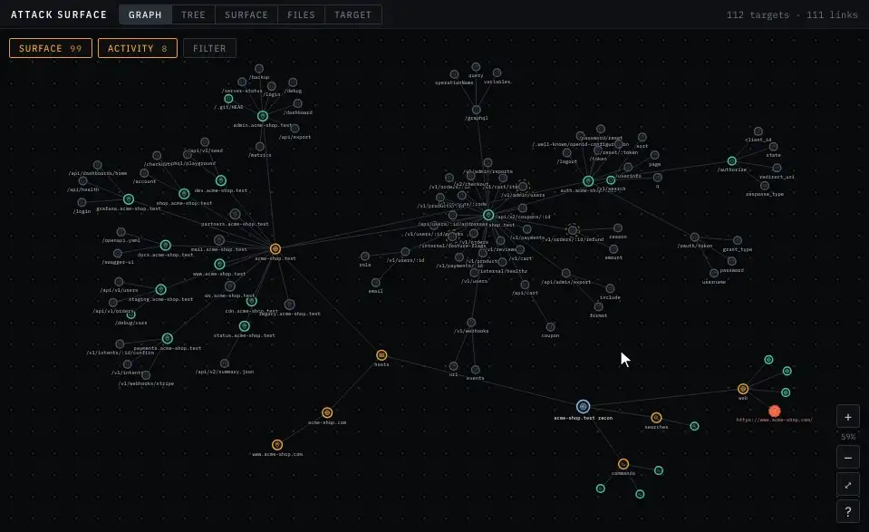
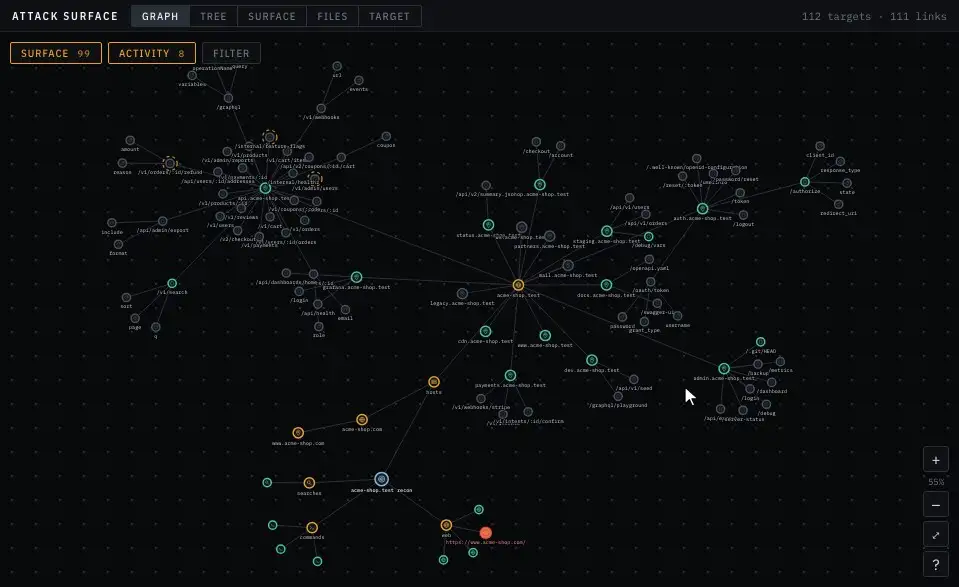
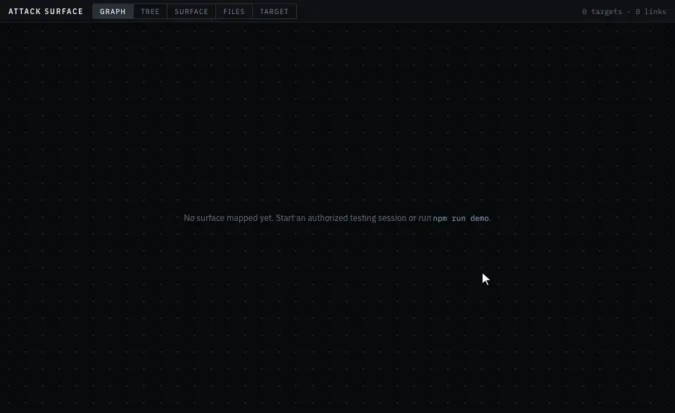

# Dashboard

The dashboard at **http://127.0.0.1:4317** is a live view of the hub's state: one map built from everything the agent touched, everything it reported, and any proxy history you imported. This page tours every part of it — the top bar, tags, triage marks and the filter bar, the five views of the Attack Surface panel, Activity, Oversight, Chain and Coverage, replay, reports, Settings, desktop alerts and the footer — and explains what the colours and marks on the map mean. The dashboard is read-only toward the agent: nothing you do here sends anything to Claude Code.

## Layout

| Position | Panel | Header shows |
|---|---|---|
| Left, full height | **Attack Surface** — Graph, Tree, Surface, Files, Target | *N targets · M links* |
| Top right | **Activity** — Stream, Objects | *N events* (the most recent 500 are kept on screen) |
| Middle right | **Oversight** — Findings, Navigator, Scope | *in scope*, or *N violations* in red |
| Bottom left | **Chain** | *N steps* |
| Bottom right | **Coverage** | |

Selecting a target is shared across the panels: select it in one view and it stays selected when you switch. Double-clicking a target — or clicking one in Activity, Oversight or Chain — opens it in the **Target** view.

## Top bar

| Item | What it does |
|---|---|
| **Session** | The id of the most recent session to start, or *Awaiting agent*. |
| **Scope badge** | *N paths · M hosts*, or *unset* before any scope exists. A red *N out of scope* pill appears with the first violation. Click it to open **Oversight → Scope**. |
| **Import HAR** | Import proxy history from a HAR file. Parsing happens in the browser; only names reach the hub. A status pill reports the result (hover for the full summary, click to dismiss). Hidden during replay. See [Proxy import](proxy-import.md). |
| **Report** | Download a Markdown report of what's on screen. See [Report](#report). |
| **Settings** | Open the Settings dialog: the Navigator's key and model, the scope, and a setup checklist. See [Settings](#settings). |
| **Replay** | Switch to replaying a recorded session. See [Replay](#replay). |
| **Live / Offline** | Whether the dashboard's WebSocket to the hub is connected. It reconnects every second while offline. Shows **Replay** instead during replay. |
| Clock | The current time in UTC. |

The browser tab title also counts violations — *(3) Spectra* — so you can see them from another tab.

## Reading the map

Every target has a **status**, shown as the colour of its outline and icon:

| Colour | Status | Meaning |
|---|---|---|
| Grey | `unexplored` — shown as **unmapped** throughout the dashboard | Known but not touched: seen only in proxy history, mapped by the agent but not yet probed, or a tool call on it failed. |
| Orange (leaves pulse) | `active` | Being worked on: a tool call touched it and hasn't returned yet, or the agent mapped it as active. |
| Green | `complete` — shown as **confirmed** throughout the dashboard | The tool call that touched it returned successfully, or the agent marked it complete. It's not a security verdict. |
| Blue | Session root | One per Claude Code session (or demo, or proxy import). |

Marks layered on top:

| Mark | Meaning |
|---|---|
| **Red** outline, red label, red-filled leaf, pulsing dashed red ring | A tool call on this target went **out of scope**. |
| Pulsing dashed **orange halo** | The [Navigator](navigator.md) recommends **pursue** for this target. |
| Dashed white ring | The selected target. |

## Tags

Every host and endpoint gets automatic **tags** that say what kind of surface it looks like. They're worked out from the hostname and the route alone:

| Tag | Given when |
|---|---|
| `api` | The hostname starts with `api.`, `rest.` or `gateway.`, or the route has a path segment `api`, `rest` or a version such as `v1`. |
| `graphql` | The route contains `graphql` or `graphiql`. |
| `auth` | The hostname starts with `auth.`, `sso.`, `login.`, `id.`, `account.`, `accounts.`, `identity.` or `oauth.`, or the route has a word such as `login`, `logout`, `signin`, `signup`, `register`, `oauth`, `authorize`, `token`, `sso`, `saml`, `password`, `reset`, `session`, `mfa`, `2fa`, `otp`, `userinfo`, `openid-configuration` or `jwks`. |
| `admin` | The hostname starts with `admin.`, `manage.`, `console.`, `backoffice.` or `staff.`, or the route has a segment `admin`, `manage`, `management`, `console`, `backoffice`, `dashboard` or `staff`. |
| `internal` | The hostname starts with `staging.`, `stage.`, `dev.`, `test.`, `qa.`, `internal.`, `debug.`, `uat.` or `sandbox.`, or the route has a segment `internal`, `debug`, `actuator`, `metrics`, `health`, `healthz`, `server-status`, `trace`, `seed` or `phpinfo`. |
| `exposed` | The route has a segment `.git`, `.svn`, `.hg`, `.env`, `.htpasswd`, `.ds_store`, `backup`, `backups` or `dump`, or ends in `.sql`, `.bak`, `.old`, `.zip`, `.tar` or `.gz`. |
| `docs` | The hostname starts with `docs.`, `developer.`, `developers.` or `swagger.`, or the route contains `swagger`, `openapi`, `api-docs`, `redoc` or `playground`. |
| `files` | The route has a segment such as `upload`, `import`, `export`, `download`, `file`, `attachment`, `avatar`, `media` or `document`. |
| `payments` | The hostname starts with `pay.`, `payment.`, `payments.`, `billing.` or `checkout.`, or the route contains `payment`, `checkout`, `billing`, `invoice`, `refund`, `coupon`, `cart`, `order`, `intent`, `subscription` or `wallet`. |
| `webhook` | The route contains `webhook` or `callback`. |
| `object-id` | The route has an `:id` or `:token` segment — an object fetched by identifier. |

- An endpoint is tagged from its route **and** its host, so every endpoint on `admin.example-shop.test` is `admin`. A host is tagged from its name only. A parameter takes its endpoint's tags.
- A target can carry several tags: `/api/admin/users/:id` is `api`, `admin` and `object-id`.
- Tags are name-based heuristics for sorting and filtering. They aren't findings, and a missing tag doesn't mean a route is safe.

Tags appear in the [filter bar](#the-filter-bar), the Surface table's **Tags** column, the Target view's header and the report.

## Triage

Triage marks are your own worklist: where each target stands in your testing plan. Only you set them — the agent and the Navigator can't.

| Mark | Meaning |
|---|---|
| **To test** | Queued: you mean to test it. |
| **Testing** | You're working on it now. |
| **Tested** | Done. |
| **Skip** | Not worth testing, or not yours to test. |

Each mark can carry a note (up to 2,000 characters) — what to try, which account, what you saw.

- Set a mark from the **Triage** column in [Surface](#surface), or from **Your triage** in the [Target](#target) view, which is also where you write the note. Choosing **—** in Surface, or **Clear** in Target, removes the mark and its note.
- Any target can be marked, not only hosts and endpoints.
- The hub records each mark as an operator event, so marks appear in the session's audit log, replay and report. Like the rest of the map, they come back when the hub restarts — see [Engagement](#engagement).
- The [Navigator](navigator.md) sees your marks. It's told that targets you marked **Skip** are yours to skip and that ones you marked **Tested** need a reason to revisit, and changing a mark makes it reassess.

## The filter bar

The Graph and Surface views share one filter. Narrow the map in one view and the other is narrowed the same way.

| Control | Keeps |
|---|---|
| Search box | Targets whose name, host or id contains the text. |
| **All / Unmapped / Active / Confirmed** | Targets with that [status](#reading-the-map). |
| **Leads only** | Targets the Navigator has scored. |
| Triage select | **Any triage**, **Not marked** (targets you haven't marked yet), or one mark: **To test**, **Testing**, **Tested**, **Skip**. |
| Tag chips | Targets carrying **every** selected tag. Each chip shows how many hosts and endpoints carry the tag; only tags present on the map are offered. |
| **Clear** | Resets everything. It appears once any filter is set. |

The controls combine: a target must pass all of them. The filter lasts until you clear it or reload the page.

## Attack Surface panel

The panel has five views, in this order: **Graph, Tree, Surface, Files, Target**.

The map has two kinds of structure. Each session has a root with a category per kind of tool — `files`, `searches`, `commands`, `web`, `agents`, `mcp`, `other` — holding one leaf per thing the agent touched. Network targets also build an attack-surface tree under `hosts`: **domain → subdomain → endpoint → parameter**. Numeric ids, UUIDs and long hex strings in URL paths collapse to `:id`, and token-like segments to `:token`, so `/api/users/42/orders` and `/api/users/97/orders` are one endpoint, `/api/users/:id/orders`. A labelled *request* edge links each tool call to the host or endpoint it hit.

### Graph

A force-directed node-link map that grows as the agent works.

| Control | Action |
|---|---|
| Scroll | Zoom toward the cursor (25% to 600%). |
| Drag the background | Pan. |
| **+** / **–** | Zoom in or out around the centre. The current zoom is shown between them. |
| **⤢** (fit) | Frame the whole map and re-engage **auto-follow**. |
| **?** | Show or hide the icon legend. |
| Click a node | Select it. |
| Double-click a node | Open it in **Target**. |
| **Surface** / **Activity** | Show or hide a layer. See below. |
| **Filter** | Open the [filter bar](#the-filter-bar). |

Filtering the Graph by tag, then hiding the Activity layer.

**Layers.** Two buttons at the top left of the graph split the map in two. **Surface** is the attack surface — hosts, endpoints and parameters. **Activity** is what the agent did — files, searches, commands, requests and everything else. Each shows its count; click one to hide or show that layer. Session roots always stay. Hiding Activity leaves a clean recon map; hiding Surface leaves the agent's trail. Layers go back to both on when you switch views.

**Filter.** The **Filter** button opens the filter bar over the graph. While a filter is set, the bar stays open and the button reads *Filter · N*, the number of targets that match. The graph doesn't remove anything:

- targets that don't match are dimmed, lose their labels, and can't be clicked until you clear the filter;
- every match keeps its ancestors lit — an endpoint stays connected to its host, domain and session root — so you can see where it sits;
- matches get a heavier outline and are always labelled, whatever the zoom.

**Auto-follow.** While following, the graph keeps re-framing itself as new targets arrive, so discoveries never land off-screen. Zooming or panning turns following off so the view stays where you put it; the fit button turns it back on.

**Labels.** Session roots, categories, endpoints, parameters, out-of-scope targets, filter matches and the selected node are always labelled. Other leaves (files, commands, searches) get labels above 170% zoom; below that, hover for the name. Edge labels appear above 80% zoom.

**Icons.** Each node carries an icon for its type. The **?** legend lists them:

| Icon | Type |
|---|---|
| Session | A session root |
| Files | A file the agent read or wrote |
| Search | A `Grep` or `Glob` |
| Shell | A shell command |
| Web | A `WebFetch` or `WebSearch` |
| Subagent | A `Task` or `Agent` call |
| MCP | A call to an MCP tool |
| Domain | A registrable domain, such as `example-shop.test` |
| Host | A subdomain, such as `api.example-shop.test` |
| Endpoint | A normalized route on a host |
| Param | A parameter name on an endpoint |
| Proxy import | The root of an imported proxy history |

Category nodes (`files`, `commands`, …) use their category's icon, the `hosts` category uses a server icon, and anything else gets a generic one.

### Tree

Walking the Tree view after the recon demo.

The same map as a collapsible outline: roots, then their categories, then leaves.

- Click the caret to collapse or expand a branch. Everything starts expanded.
- Within a branch, containers sort before leaves, then alphabetically.
- Container rows show how many leaves sit beneath them.
- The right-hand columns show the tool that touched a leaf (or the node's kind for containers) and its status chip.
- Out-of-scope rows have a red bar and an *out of scope* tag.
- Click a row to select it; double-click to open it in **Target**.

### Surface

Sorting and filtering the Surface table while the attack surface comes in.

A live, sortable table of the attack surface — the view to use when the graph gets too big to read.

**Show** switches between three tables (default **Endpoints**). Each option shows how many of that kind are on the map:

| Show | Columns |
|---|---|
| **Endpoints** | `#` (discovery order), **Endpoint**, **Host**, **Tags**, **Lead**, **Triage**, **Status**, **Source**, **Params**, **Requests**, **Findings** |
| **Hosts** | `#`, **Host**, **Domain**, **Tags**, **Best lead** (the highest-scored lead among its endpoints), **Triage**, **Status**, **Endpoints**, **Source** |
| **Params** | `#`, **Param**, **Endpoint**, **Host**, **Status**, **Source**, **Triage** |

What the columns mean:

| Column | Meaning |
|---|---|
| `#` | The order the target first appeared on the map. |
| **Tags** | The target's automatic [tags](#tags). |
| **Status** | *unmapped*, *active* or *confirmed* — see [Reading the map](#reading-the-map). |
| **Source** | **agent** — touched or reported by the agent (hooks, observer or MCP); **proxy** — seen only in imported proxy history; **both** — the agent touched it and the proxy saw it. |
| **Params** / **Endpoints** | How many parameters sit under the endpoint, or endpoints under the host. |
| **Requests** | How many requests the imported proxy history had for it. |
| **Lead** | The Navigator's recommendation (*pursue*, *watch* or *skip*) and confidence. Hover for its rationale. |
| **Best lead** | The strongest lead on the host or any of its endpoints. |
| **Triage** | Your [triage mark](#triage), as a menu: pick a mark to set it, or **—** to clear it. Hover for your note. |
| **Findings** | How many findings reference it. |
| **Domain** | The domain a subdomain belongs to; empty for a domain itself. |

**Sorting.** Click a column header to sort by it; click it again to reverse. Numeric columns sort highest first on the first click. **Lead** ranks *pursue* above *watch* above *skip*, then by confidence. **Triage** puts unmarked targets first, then *Skip*, *Tested*, *To test* and *Testing*; click again to bring what you're testing to the top. The default sort is newest first (`#` descending), so new discoveries appear at the top as they come in, and new rows briefly highlight.

**Filters.** The [filter bar](#the-filter-bar) sits above the table — search, status, **Leads only**, triage and tag chips — and it's the same filter the Graph uses. The count on the right tells you how many rows match, for example *12 of 87 endpoints*. The Params table has no Tags column, but tag chips still filter it, by each parameter's endpoint.

**Export CSV** downloads the rows currently shown — after filtering, in the order on screen — as `spectra-endpoints.csv`, `spectra-hosts.csv` or `spectra-params.csv`. It has the table's columns plus a **Triage note** column. Every value is quoted, and values a spreadsheet would read as a formula are neutralized.

Click a row to select it; double-click to open it in **Target**.

### Files

Review coverage of the in-scope code: every file under the scope paths, marked by how the agent touched it.

- The header reads *X of Y files opened (Z%) · N edited*.
- Each directory shows a coverage bar with *opened/total*.
- Files are marked **read**, **edited** or **never opened**, with read and write counts (`3r 1w`) and the time of the last touch.
- **Unopened only** hides everything the agent has already opened — a list of what it hasn't looked at.
- **Refresh** re-lists the files from disk. The list also reloads when the scope changes.

Only files touched through structured tools (`Read`, `Edit`, `Write` and similar) count; paths pattern-matched out of shell commands don't. The listing skips `node_modules`, `.git`, `dist`, `build`, `.next`, `vendor`, `__pycache__`, `.venv`, `venv`, `target` and `coverage`, doesn't follow symlinks, and stops at 20,000 files. With no scope paths set, the view says so.

### Target

One target in detail. It shows the selected target, or the first session root if nothing is selected.

- **Header**: its kind, label, status, an *out of scope* tag if it went out of scope, and its [tags](#tags).
- **Ego graph**: the target in the middle with up to 16 neighbours around it (*+N* for the rest). Click a neighbour to move to it.
- **Properties**: id, kind, category, parent (click to move to it), importance, and anything else recorded about it — for example the tool and key for a tool-call leaf, the host and an example URL for an endpoint, or *seen in*, *requests*, *methods* and *status codes* from proxy history.
- **Your triage**: buttons for **To test**, **Testing**, **Tested** and **Skip**, a note box, and **Clear** once a mark is set. The note is saved with the mark: write it, then pick a mark, or edit it on a marked target and click **Save note**. See [Triage](#triage).
- **Navigator's lead**: when the Navigator has scored this target, its recommendation, confidence, suspected bug class and rationale.
- **Scope violations**: time, access, target and tool for each violation on this target.
- **Connections**: every edge in and out, with its label (*contains*, *parent*, *request*, or the agent's own label) and the other end's status.
- **Activity**: the last 30 tool calls on this target with their result (*OK*, *ERR*, or *…* while running), and the chain steps that reference it.

## Activity

**Stream** shows the agent's reasoning and tool calls, newest first (the last 120).

- Reasoning comes from the log observer (the agent's thinking and replies, up to 400 characters each), from your prompts via hooks (tagged *operator prompt*), from `log_thought`, and from proxy imports (tagged *proxy import*).
- Tool calls show the tool and its main argument. Out-of-scope calls have a red bar and an *out of scope* tag.
- Click a tool call to open its target.

**Objects** lists every leaf on the map as a card with its category and importance. Sort by **Importance**, **Category** or **Status**; click a card to open it.

## Oversight

### Findings

Findings sorted by status (confirmed, suspected, fixed, dismissed), then severity, then confidence. Each row shows:

- severity, title, and the reporter's confidence as a bar and percentage;
- the finding's id and file location;
- the reporter's own status claim;
- *agent-reported* if it came through the MCP server — a claim to check;
- the Navigator's verdict and confidence, if it has given one (hover for its rationale);
- your verdict, or *Unreviewed*.

Click a finding to expand it:

- the description;
- **Evidence trail**: the chain steps that led to it, in order (click one to open its target);
- **Remediation**: edits the agent made to the finding's file, linked automatically by the hub. If the finding has no file location, edits can't be linked;
- **Objects**: the targets that support it;
- **Your review**: a notes box and **Verified**, **Rejected** and **Needs info** buttons. Your verdict is recorded by the hub as an operator event, separate from the agent's claim and the Navigator's verdict.

### Navigator

The Navigator's leads, sorted pursue, watch, skip, then by confidence. Each shows the recommendation, a title, the confidence, the suspected bug class, the target, and a one-line rationale. Click one to open its target. Before the Navigator has posted anything, this tab says so and names `npm run validator`; turning the Navigator on in [Settings](#settings) does the same job. See [Navigator](navigator.md#reading-its-output).

### Scope

- **Set by**: *Operator config* (the config file, environment, the scope editor in [Settings](#settings) or `POST /scope`), *Session working directory*, or *Not set*.
- **Paths** and **Hosts** in force.
- **Violations**, newest first: time, severity (*high* or *med*), access (read, write, exec or network), the target, the tool, and *parsed from shell* when the target was pattern-matched out of a shell command. Click one to open its target.

## Chain

The attack chain the agent built with `update_chain`, drawn left to right: each step sits one column after the steps it follows. Confirmed steps have a green bar. Hover a step for its detail; click it to open the first target it references.

## Coverage

A spectrum bar and counts of **unmapped**, **active** and **confirmed** targets, the share that's confirmed (*coverage*), and the stage of the engagement: **Discovery** (targets on the map), **Linking steps** (chain steps exist), **Confirmed paths** (a chain step is confirmed).

## Replay

Click **Replay** to load a recorded session from the audit log and play it back through the same reducer the live view uses. It opens the current session if it has been recorded, otherwise the most recent one.

| Control | Action |
|---|---|
| Session list | Pick any recorded session. |
| Step back / Play / Step forward | Move one event at a time, or play. |
| Scrubber | Drag to any point. Markers show scope violations and findings. |
| Position | *event/total* and the event's time. |
| **1× 4× 16× 64×** | Playback speed (default 4×). Playback follows the recorded gaps between events, sped up, with no gap longer than 0.8 s. |
| **Back to live** | Return to the live view. |

While replaying, every panel shows the session as of the scrubber position, **Report** exports that state, and the footer verifies the replayed session's log. Triage marks are read-only during replay — the marks shown are the ones recorded in that session — and **Settings** still acts on the live hub. Replay needs the audit log, so it has nothing to show if the hub runs with `SPECTRA_PERSIST=0`.

## Report

**Report** downloads `spectra-report-<session>.md`, a Markdown summary of what's on screen:

- the session id, time span, tool-call count (and failures) and files opened and edited;
- the scope and who set it;
- a summary table of findings by severity and your verdicts, and the number of violations;
- **Attack surface**: the number of hosts, endpoints and parameters, a tally of your triage marks, and then, for each host with endpoints or a triage mark, the host's tags and mark and a table of its endpoints — tags, status, who saw it (*agent*, *proxy* or *agent + proxy*), parameters, the Navigator's lead and your triage mark and note;
- each finding with its severity, the agent's confidence and status, the Navigator's verdict (a *Navigator:* line with its confidence and rationale, when it has given one), your verdict and note, location, description, evidence trail and remediation;
- a table of scope violations;
- the files edited;
- the audit log's verification result and **head hash**, with the `npm run verify` command to check it later. See [Security](security.md#the-audit-log).

The report ends with a note on how far to trust each part: agent-reported findings are claims, verdicts and triage marks are yours, Navigator entries are advice, and tags are name-based heuristics.

## Settings

**Settings** in the top bar opens a dialog with four sections. Close it with **Close**, Escape, or a click outside it. It always shows the live hub, even during replay, and refreshes every 3 seconds.

### Navigator key and model

Run the [Navigator](navigator.md) inside the hub, with no second terminal.

| Control | What it does |
|---|---|
| State pill | **Off**, **Running** (waiting for the map to change), **Assessing…** (a model call is in flight) or **Stopped** (an error it can't recover from — the reason is shown below). |
| **API key** | Paste an Anthropic API key and click **Save key** (or press Enter). The field is write-only: the hub stores the key and never sends it back, so afterwards the field shows only *Saved (…abcd)* — the last four characters. **Remove** deletes a saved key and turns the Navigator off. |
| **Model** | The model id, `claude-opus-5-5` by default. Type one or pick a suggestion; it's saved when you leave the field. |
| **Test connection** | Sends one tiny request with the saved key and model and reports *Connected. The key and model work.* or the reason it failed. Available once a key exists. |
| **Run the Navigator in the hub** | Turns it on or off. Disabled until a key exists. |

The line under the checkbox shows how many assessments have run, when the last one was and how much it posted, and the last error if there was one.

The key is kept in `~/.spectra/settings.json`, readable only by you. If the hub was started with `ANTHROPIC_API_KEY` in its environment, Settings says so and uses that key until you save one here. See [Navigator → Running it](navigator.md#running-it) for what turning it on means, and [Security](security.md#the-navigators-api-key) for how the key is handled.

### Scope editor

Edit the scope without restarting the hub: **Paths** and **Hosts**, one per line, then **Save scope**.

- Saving replaces the hosts with what's in the **Hosts** box. Paths are replaced only when you edit them (or when you'd already set them yourself): paths that came from sessions' working directories are left alone if you only change hosts.
- If you do clear **Paths** and save, no directory is in scope and every file access is flagged.
- Hosts include their subdomains. If you paste a URL, it's reduced to its hostname. Loopback isn't listed, but it's always in scope.
- Once you've saved paths here, they count as set by you, so new sessions no longer add their working directories. Hosts you add stay in place when a new session starts.
- The change is recorded like any other scope change and is kept with the engagement, so it's still there after a hub restart — unless `spectra.config.json` sets paths, which always win at startup. Put the scope in that file to make it the default. See [Setup → Set your scope](setup.md#1-set-your-scope).

The boxes are filled in when the dialog opens; reopen it to pick up a scope that changed elsewhere.

### Engagement

An engagement is everything on the live map: the targets, your triage marks and notes, findings, the Navigator's leads, scope violations and the scope itself. The hub keeps it across restarts.

- **How it's kept.** The hub remembers which recorded sessions belong to the current engagement, and when it starts it rebuilds the map from their audit logs. The startup line `[spectra] restored the engagement: N events from M sessions` and this section (*restored N events when the hub started*) confirm it. Nothing is restored when the audit log is off (`SPECTRA_PERSIST=0`).
- **New engagement** clears the live map for the next target, after a confirmation. It clears it for every open dashboard. Recorded sessions aren't deleted: they stay in [Replay](#replay), and their logs still verify.
- **A session that's still running** when you start a new engagement joins the new one with its next event, and only brings what it does from then on.
- **Scope.** A new engagement starts with the scope from `spectra.config.json`, or none.
- To start empty without the dashboard, start the hub with `SPECTRA_RESUME=0`.

One difference after a restore: Activity shows the scope as it stood when each session's log opened, not each of your individual scope edits before that.

### Setup checklist

A checklist of what's connected, from the hub's `GET /health`. Each row has a status dot: **ok**, **to-do**, **optional** or **warning**.

| Row | OK when | Otherwise |
|---|---|---|
| **Hub** | Always — it shows when the hub started and how many events it holds. | |
| **Scope** | A scope exists: *N paths · M hosts*. | To-do: *Not set*. |
| **Claude Code hooks** | A hook event has arrived: when, and from how many sessions. | To-do, with the install command. If the log observer is on, it says activity is coming from Claude Code's session logs meanwhile. |
| **Agent annotations (MCP)** | The agent has sent an annotation through the MCP server. | Optional. |
| **Navigator** | It's running in the hub, or a separate `npm run validator` process has posted advice. | Optional when it's off; a warning with the reason when it has stopped on an error. |
| **Proxy history** | A HAR file has been imported. | Optional. |
| **Audit log** | It's on: the row shows its directory. | A warning when the hub runs with `SPECTRA_PERSIST=0`. |

The checklist reports what has reached this hub since it started, so after a restart the hooks, MCP and proxy rows wait for the next event, even though the map itself is restored. The demos count too: their scripted Navigator leads and proxy import mark those two rows OK without a real Navigator or proxy.

## Desktop alerts

Each scope violation raises a desktop notification — *Spectra: out-of-scope network*, with the target — through `osascript` on macOS and `notify-send` on Linux. Bursts are collapsed: at most one alert every 5 seconds, and the next one says how many were held back (*+3 more*). If nothing appears, check your system's notification settings. Turn alerts off with `SPECTRA_NOTIFY=0`.

## Footer

| Item | Meaning |
|---|---|
| **Hub** | The address the dashboard is connected to. |
| **Hooks · Observer · MCP** | The three ways the agent's activity reaches the hub. |
| **Audit log** | The session's audit-log status, rechecked every 30 seconds. See below. |
| **Last event** | The time of the most recent event. |

The audit-log status reads one of:

| Status | Meaning |
|---|---|
| *Audit log verified · N events · head 1a2b3c4d5e6f* | The hash chain is intact. Click to copy the full head hash — record it somewhere else to detect a later rewrite. |
| *Audit log FAILED at line N: reason* | The chain is broken at that line. Click to check again. See [Troubleshooting](troubleshooting.md#audit-log-fails-verification). |
| *Audit log: audit log disabled* | The hub runs with `SPECTRA_PERSIST=0`. |
| *Audit log: log file not found* | Nothing has been recorded for this session. |
| *Audit log —* | No session yet. |

---

**Next:** [Navigator](navigator.md)
