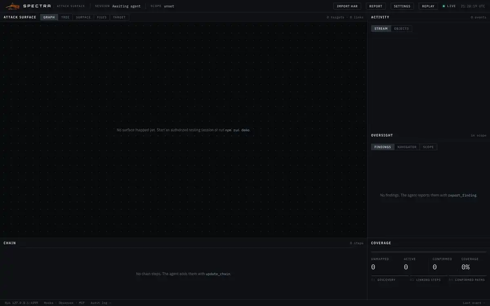
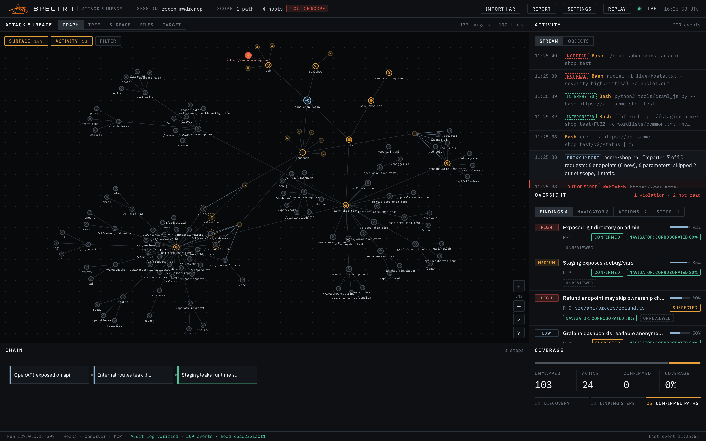

# Getting started

This page gets Spectra running on your machine and shows you what it does before you point it at anything real. You'll install it, start the hub and dashboard with `npm start`, and run one of two scripted demos against a fictional target, `acme-shop.test`. Nothing in the demos touches the network — they post pre-written events to your local hub — so they're safe to run anywhere. When you're done, [Setup](setup.md) connects a real Claude Code session.

## Requirements

| | |
|---|---|
| Node.js | 20 or later |
| OS | macOS or Linux. Windows through WSL. |
| Claude Code | Needed for real sessions. The demos don't need it. |
| Anthropic API key | Only if you run the [Navigator](navigator.md) or the [Interpreter](interpreter.md). The demos don't need it. |

## Install

```bash
git clone https://github.com/joshmaster2165/spectra.git
cd spectra
npm install
```

## Start the hub

```bash
npm start
```

`npm start` builds the dashboard, then starts the hub. You'll see something like:

```
[spectra] hub on http://127.0.0.1:4317
[spectra] dashboard on http://127.0.0.1:4317
[spectra] scope: each session's working directory
[spectra] audit log: ~/.spectra/sessions
[spectra] observing Claude Code transcripts
```

(The audit-log line prints the full path.) Open **http://127.0.0.1:4317**. The top bar shows **Live** once the dashboard is connected, and the map says *No surface mapped yet* until something arrives.

Leave this terminal running. The hook, the MCP server, the Navigator, the importer and the demos all talk to this hub.

## Run a demo

Open a second terminal in the same directory and run one of the two demos. Both are scripts: they post events to the hub the way a real session would, labelled with the source `demo`, so you can explore the dashboard without an agent.

> Each demo sets the scope to its own target (`/work/acme-shop…` and `acme-shop.test`), replacing whatever scope you had until you set a new one. The hub keeps its map across restarts, so when you're done with a demo, clear it with **Settings → New engagement**. The demo sessions stay in the audit log and can still be [replayed](dashboard.md#replay).

### The short demo: `npm run demo`

```bash
npm run demo
```

The story, in under a minute:

1. The operator authorizes `acme-shop.test` (the demo plays the operator and sets the scope).
2. The agent reads the server's entry point, searches for routes, and maps the API on `api.acme-shop.test`: `/api/login`, `/api/cart`, `/api/orders`, `/api/users/:id`.
3. It follows the session cookie into the cart and probes it.
4. It sends one request to **production** (`api.acme-shop.com`) — out of scope. That node turns red, the scope badge shows the violation, and you get a desktop alert.
5. It reports a finding — *Cart trusts unsigned user id from cookie* — and confirms it.
6. It edits `src/routes/cart.ts`; the hub links that edit to the finding as remediation.
7. The operator's proxy history (`examples/acme-shop.har`) is imported. Endpoints the agent never touched, such as `/api/admin/export`, appear as **unmapped**.
8. The Navigator's leads and verdicts arrive (scripted here — no API key involved).

### The recon demo: `npm run demo:recon`



<sub>The recon demo as it runs. A <a href="media/demo.mp4">full-quality MP4</a> is also available.</sub>

```bash
npm run demo:recon
```

A bigger engagement, around 110 targets: subdomain enumeration of `acme-shop.test`, probing which hosts serve HTTP, API routes from an OpenAPI document, the OIDC surface on `auth`, content discovery on `admin`, routes mined from a JS bundle, endpoints across the rest of the estate, one stray request to `www.acme-shop.com` (production, flagged red), four findings, the proxy-history import, and the Navigator's read.

Set `SPECTRA_DEMO_PACE` below 1 to run it faster, for example `SPECTRA_DEMO_PACE=0.5 npm run demo:recon`.

## What you're looking at



| Area | What it shows |
|---|---|
| **Top bar** | The current session, the scope badge (red when anything went out of scope), Import HAR, Report, Settings, Replay, and whether the dashboard is live. |
| **Attack Surface** (left) | The map, in five views: Graph, Tree, Surface, Files and Target. |
| **Activity** (top right) | The agent's reasoning and tool calls as they happen, and a list of every target. |
| **Oversight** (middle right) | Findings with their evidence, the Navigator's leads, the actions Spectra couldn't read, and the scope with its violations. |
| **Chain** (bottom left) | The attack chain: how individual steps connect into a finding. |
| **Coverage** (bottom right) | How much of the map is unmapped, active or confirmed. |
| **Footer** | The hub address, the audit log's status and head hash, and the time of the last event. |

A few things to try after the short demo:

- Click the red node in the graph, then double-click it to open it in **Target**: you'll see the violation, the tool that caused it, and its connections.
- Open **Oversight → Findings** and click the cart finding to expand its evidence trail, the linked edit, and the review buttons.
- Switch the map to **Surface** and sort by **Lead** to see the Navigator's picks first, or filter by **Unmapped** to see what only the proxy saw.
- Click **Replay** to scrub back through the session, then **Back to live**.
- Click **Report** to download a Markdown summary with the audit log's head hash.

[Dashboard](dashboard.md) covers every panel in detail.

## Next steps

- [Setup](setup.md): set your scope and connect a real Claude Code session.
- [Proxy import](proxy-import.md): put your own proxy history on the map.
- [Navigator](navigator.md): add the second model that scores leads.
- [Interpreter](interpreter.md): see which commands Spectra couldn't read, and have a model read their output.

---

**Next:** [Setup](setup.md)
