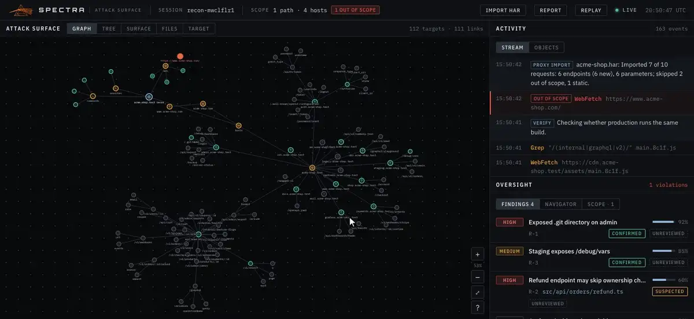

# Navigator

The Navigator is an optional second model that sits in the "second seat". Claude Code — the driver — acts on the target; you, the operator, set the scope and decide; the Navigator only reads. It sees the same map you see, points at where the promise is with scored **leads** (pursue, watch or skip, a suspected bug class, a confidence and a rationale), and gives an independent **verdict** on each finding the driver reports. It never touches the target, can't set the scope, your verdicts or your triage marks, and is the only part of Spectra that sends data off your machine. You can run it inside the hub, switched on from the dashboard's **Settings**, or as a separate process.

## What it is



<sub>The Navigator scoring the recon demo's map: leads with confidence, halos on the graph, verdicts on findings.</sub>

The Navigator is one class (`packages/server/src/navigator.ts`) that runs in either of two places: inside the hub, when you turn it on in Settings, or in a process of its own, started with `npm run validator`. Either way it works from the same state the dashboard shows and periodically asks a model to read it. Its output is advice, kept apart from everything else:

| Seat | Who | Does | Spectra labels it |
|---|---|---|---|
| Driver | Claude Code | Acts on the target | Ground truth (hooks, observer) or claims (MCP) |
| Navigator | A second model | Reads the map, scores leads, checks findings | Advice (`validator`) |
| Operator | You | Sets scope, reviews findings | Authority (`operator`) |

## Running it

There are two ways to run the Navigator. Use one or the other, not both at once: each would assess every change, so you'd pay for two sets of model calls and get duplicate advice.

### In the hub, from Settings

1. Click **Settings** in the dashboard's top bar.
2. Under **Navigator**, paste an Anthropic API key and click **Save key**.
3. Leave the model as `claude-opus-5-5`, or enter another model id.
4. Click **Test connection**. The hub sends one tiny request with the saved key and model and reports *Connected. The key and model work.* or the reason it failed — so a bad key shows up here, not mid-engagement.
5. Tick **Run the Navigator in the hub**. The box is disabled until a key exists.

What to know:

- **The hub makes the calls.** While the box is ticked, the hub process itself calls the Anthropic API. With it unticked, the hub makes no outbound connections, apart from one request each time you click **Test connection**.
- **Where the key lives.** The hub writes it to `~/.spectra/settings.json` (or the file named by `SPECTRA_SETTINGS`), readable and writable only by you (mode `600`). The key is write-only from the dashboard: the hub returns only whether a key is saved and its last four characters, never the key. **Remove** deletes it and turns the Navigator off.
- **A key in the environment works too.** If the hub was started with `ANTHROPIC_API_KEY` set and no key is saved, Settings shows that it's using the environment's key. A key saved in Settings takes its place.
- **It stays on.** The setting is saved with the key, so the Navigator starts again with the hub until you untick the box.
- **Saving a setting restarts it.** A new key, model or on/off change starts a fresh Navigator, which reassesses the map as it stands, and its assessment count starts again from zero.
- **Its log lines go to the hub's terminal**, for example `[navigator] posted 7 assessment(s) for session …`.

[Dashboard → Settings](dashboard.md#settings) describes every control.

### As a separate process

`npm run validator` runs the same Navigator in its own process (`packages/server/src/validator.ts`). It connects to the hub like a dashboard does, keeps its own copy of the state, and posts its advice to the hub's `/validator` route. Start it once the hub is up:

```bash
export ANTHROPIC_API_KEY=sk-ant-...
npm run validator
```

It prints `[navigator] watching ws://127.0.0.1:4317/ws with claude-opus-5-5` and logs each post to its own terminal. It reads its key and model from its own environment, not from Settings. Stop it with Ctrl-C.

Use this when you want the hub itself to stay offline, or to run the Navigator with different credentials from another shell.

### States

Settings shows the state of the Navigator in the hub next to its heading:

| Shown as | State | Meaning |
|---|---|---|
| **Off** | `off` | Not turned on, or no key is available. |
| **Running** | `idle` | On, and waiting for the map to change. |
| **Assessing…** | `assessing` | A model call is in flight. |
| **Stopped** | `error` | The API rejected the key, the key isn't allowed to use the model, or the model wasn't found. It stays stopped until you change the settings; the reason is shown under the checkbox and in the Setup checklist. |

Other failures — rate limiting, a network problem, any other API error — don't stop it. It goes back to **Running**, shows *Last error: …*, and tries again after the next change. The separate process handles the same three fatal errors, and having no key at all, by logging the reason and exiting with code 1.

Stopping the Navigator, either way, leaves its leads and verdicts on the map and in the audit log.

## How it works

1. **It reads the hub's state.** In the hub, it reads the state directly. As a separate process, it connects to `ws://127.0.0.1:4317/ws` (from `SPECTRA_HUB`), receives the same snapshot and event stream as the dashboard, and rebuilds the state with the same reducer; if the connection drops, it retries every 3 seconds.
2. **It waits for a quiet period.** Every event restarts a timer — new targets, tool calls and findings, and also your triage marks, reviews and scope changes. When no event has arrived for 2.5 seconds (`SPECTRA_VALIDATOR_IDLE_MS`), it assesses the map — but never more often than once every 15 seconds, and never while a previous assessment is still running. Its own posts don't restart the timer. An empty map isn't assessed.
3. **It sends a digest.** The model gets a compact text summary of the state, not the raw events:
   - the scope (paths and hosts) and who set it;
   - up to 200 targets — the attack surface (hosts, endpoints, parameters) first, newest first, then files, searches and commands — each with its id, label, kind, status, category, proxy-traffic details (*seen in*, request count, status codes), your [triage mark](dashboard.md#triage) if you set one (the mark, not your note), an `[OUT OF SCOPE]` tag where it applies, and the lead it gave that target last time;
   - every finding with its severity, status, who reported it, location, description, and the titles of its chain steps;
   - counts of unexplored, active and complete targets.
4. **It gets leads and verdicts back through a tool call.** The model is given one tool, `submit_navigation`, and asked to call it once with a list of leads and a list of finding verdicts.
5. **It checks them and posts them to the hub.** Leads for unknown or out-of-scope targets and verdicts for unknown findings are dropped, recommendations and verdicts outside the allowed values are corrected or dropped, and confidences are clamped to 0–1. The rest are recorded with the source `validator`: published directly when the Navigator runs in the hub, or sent to the hub's `POST /validator` endpoint by the separate process.

## Leads

A lead is the Navigator's scored read on one target.

| Field | Meaning |
|---|---|
| **Recommendation** | **pursue** — worth the driver's time now; **watch** — keep it in view; **skip** — not worth it. An unrecognized value becomes *watch*. |
| **Bug class** | A short suspected class, such as `idor`, `authz`, `injection`, `ssrf`, `secrets` or `auth-bypass`. |
| **Confidence** | 0–1: the Navigator's estimate that the area hides a real, in-scope bug. |
| **Rationale** | One or two lines on why. |
| **Title** | A short name for the lead. |

There is one lead per target: each new assessment of a target replaces the previous one. Leads aren't removed when the Navigator stops mentioning a target, so a lead can be older than the latest assessment.

The prompt asks it to favour reachable, unauthenticated, and authentication- or identity-bearing surfaces and places the driver hasn't explored yet — and says that *skip* is a useful answer. It also tells it that targets you marked **Skip** are yours to skip, and that targets you marked **Tested** need a reason to revisit.

## Finding verdicts

For each finding, the Navigator gives a verdict judged only from the evidence chain and the map:

| Verdict | Meaning |
|---|---|
| **Corroborated** | The evidence supports the finding. |
| **Unconvinced** | The evidence doesn't support it. |
| **Needs evidence** | It may be real, but the chain or probes to show it aren't there yet. |

Each verdict carries a 0–1 confidence and a rationale. A new verdict replaces the previous one. It's shown next to the driver's own status and your review, never merged with either.

## Traffic-only targets

Targets seen only in imported proxy history (*seen in proxy traffic*) crossed the wire but were never tested by the driver. The Navigator is told this and treats them as strong candidates when they look sensitive — an admin route the proxy saw succeed is a typical *pursue*. See [Proxy import](proxy-import.md).

## Guardrails

- **Never advises on out-of-scope targets.** The prompt forbids it, and independently of the model, any lead for a target marked out of scope is discarded before it reaches the hub.
- **Triage, not payloads.** It's instructed to give direction and prioritization only — no exploit payloads, step-by-step intrusion instructions or code — and its tool only has fields for leads and verdicts. If the model declines an assessment, that cycle is skipped.
- **Can't set scope, verdicts or triage.** Whichever way it runs, its output is limited to two event types — leads and finding verdicts — stamped `validator`. The hub accepts nothing else on `/validator`: scope changes, operator reviews, triage marks and everything else are ignored there. The agent's MCP channel, in turn, can't produce leads or verdicts.
- **Read-only toward the target.** It has no tools that act on anything; its only outputs are leads and verdicts on your local hub.

## Configuration

| | In the hub | As a separate process |
|---|---|---|
| API key | The key saved in Settings; otherwise `ANTHROPIC_API_KEY` in the hub's environment. | `ANTHROPIC_API_KEY` in its own environment, read by the Anthropic SDK. |
| Model | The model saved in Settings; otherwise `SPECTRA_VALIDATOR_MODEL` in the hub's environment; otherwise `claude-opus-5-5`. | `SPECTRA_VALIDATOR_MODEL`; otherwise `claude-opus-5-5`. |
| Quiet period before an assessment | `SPECTRA_VALIDATOR_IDLE_MS` in the hub's environment, in milliseconds (default `2500`). | The same variable in its own environment. |
| Hub to watch and post to | — | `SPECTRA_HUB` (default `http://127.0.0.1:4317`). |
| On or off | The checkbox in Settings, saved in the settings file. | Running or not. |

Fixed in the code: at most one assessment every 15 seconds, at most 200 targets in the digest, and at most 4,000 output tokens per assessment.

The settings file and `SPECTRA_SETTINGS` are described in [Configuration](configuration.md#the-settings-file).

## Cost and egress

- **Egress.** The Navigator is the one part of Spectra that connects outside your machine, to the Anthropic API. The process making the calls is the hub itself when the Navigator is turned on in Settings, or the `npm run validator` process otherwise. What it sends is the digest above, which includes target ids and labels — file paths, shell commands, hostnames and URL paths — the scope, your triage marks, and finding titles and descriptions. It doesn't send file contents or your triage notes. **Test connection** sends one short fixed prompt and nothing from the map. Leave the Navigator off for zero egress.
- **Cost.** One model call per assessment, at most one every 15 seconds while the map keeps changing, and none while it's idle. Input grows with the map up to the 200-target cap; output is capped at 4,000 tokens. A long, busy session means many calls — turn the Navigator off when you don't need it. Marking triage and changing the scope count as changes, so they trigger a reassessment too.
- **Coverage limit.** The digest holds 200 targets. On a larger map the attack surface is kept, newest first, and files, searches and commands drop out first; on a very large surface the oldest hosts and endpoints go too.

## Reading its output

- **Oversight → Navigator** lists every lead, pursue first, then by confidence.
- **The graph** puts a pulsing orange halo on every target the Navigator says to pursue.
- **Surface** has a **Lead** column (and **Best lead** for hosts) you can sort by, and **Leads only** in the filter bar narrows both the Graph and the Surface table to scored targets.
- **Target** shows a **Navigator's lead** section for a scored target: the recommendation, confidence, bug class and rationale.
- **Oversight → Findings** shows *Navigator: Corroborated 86%* (or the verdict it gave) on each finding it has assessed; hover for the rationale.
- **The report** lists each endpoint's lead in its *Attack surface* section and adds a *Navigator:* line to each finding it has assessed.
- **Settings** shows the number of assessments, when the last one ran and how much it posted (for the Navigator in the hub).
- The terminal logs each post: `[navigator] posted 7 assessment(s) for session …` — the hub's terminal when it runs in the hub, its own under `npm run validator`.

Treat a lead as a second opinion on where to look next, not as evidence. A *corroborated* verdict means the chain hangs together on paper; your review is still the one that counts.

---

**Next:** [Proxy import](proxy-import.md)
